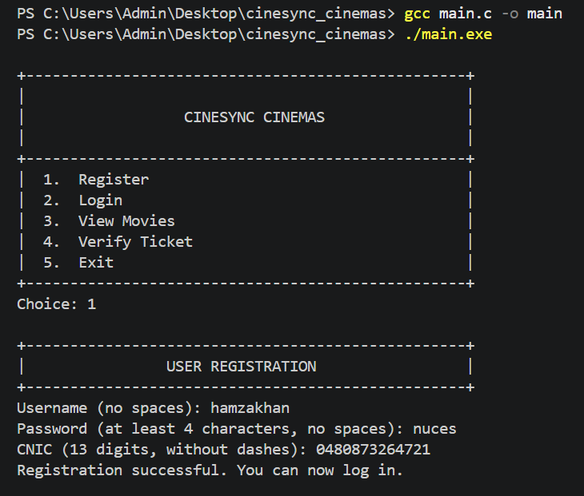
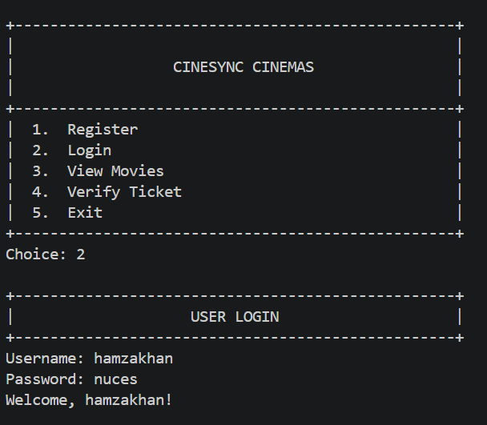
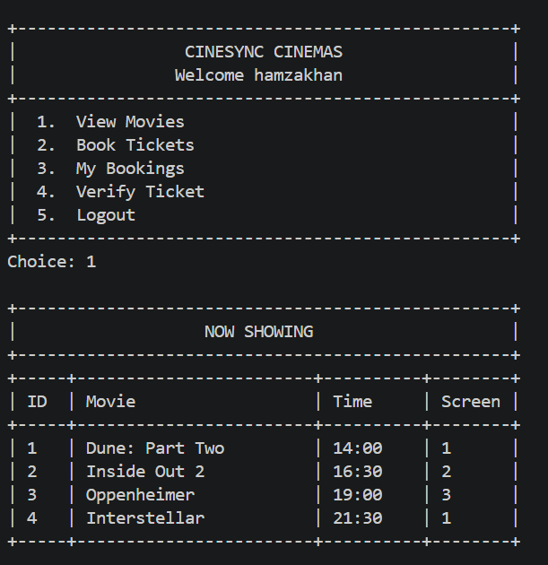
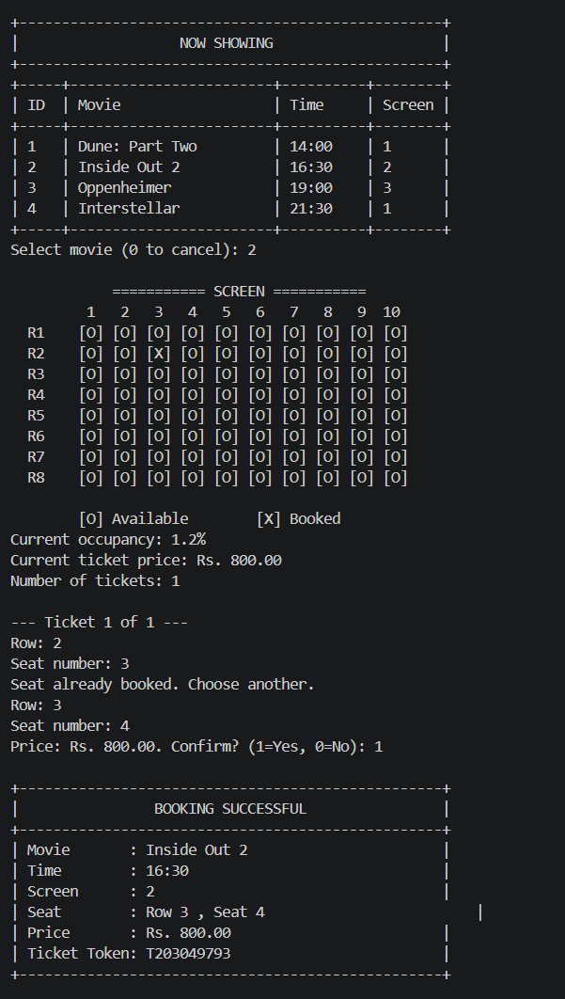
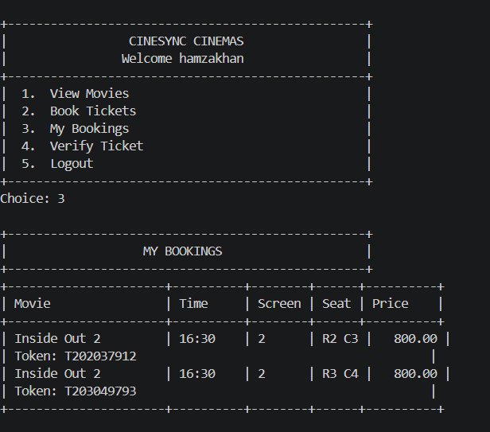
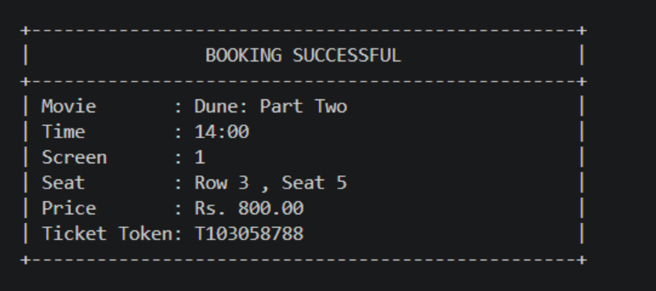

# 🎬 CineSync
## Automated Cinema Ticketing System

**Book seats, beat the scalpers, and let demand set the price, all from your terminal.**

**C11 · Windows / Linux · Console application**

---

## 📖 About

CineSync is a console-based cinema ticketing application written in C. Customers can register, log in, view the movie schedule, see a live seating grid, and book tickets that are saved as scrambled, verifiable ticket files.

## 📌 Problem it solves

Basic booking programs usually have two weaknesses:

- **Ticket hoarding (scalping):** one buyer can purchase whole rows of popular seats under one identity.
- **Fixed pricing:** the ticket price never reacts to real demand.

CineSync handles both by limiting tickets per CNIC and by raising the price automatically when a hall fills up.

## ✨ Features

| Feature | What it does |
|---|---|
| 🪑 **Live seating grid** | Each hall is an 8 × 10 (80 seat) 2D character array. [O] = available, [X] = booked. |
| 🛡️ **Anti-scalper limit** | A CNIC can hold at most 4 tickets per movie; booking is blocked after that. |
| 💸 **Dynamic pricing** | Rs. 800 per seat normally, Rs. 1200 once the hall reaches 70% occupancy (56 of 80 seats). Re-checked after every ticket, even mid-transaction. |
| 🔑 **User authentication** | Register and log in with duplicate username and CNIC checks. Passwords are never stored as plain text. |
| 🎟️ **XOR ticket verification** | Ticket files are XOR-scrambled and stored as hex. Verification rebuilds the expected text from bookings.txt, so edited or fake tickets are rejected. |
| 📋 **My Bookings** | A logged-in user can see all of their tickets and tokens. |
| ✅ **Input validation** | Menus and numeric inputs are validated and re-asked, so wrong input does not crash the program. |
| 💾 **Persistent storage** | All data is kept in plain .txt files using C file handling. |

## 🎞️ Now showing

| ID | Movie | Time | Screen |
|---|---|---|---|
| 1 | Dune: Part Two | 14:00 | 1 |
| 2 | Inside Out 2 | 16:30 | 2 |
| 3 | Oppenheimer | 19:00 | 3 |
| 4 | Interstellar | 21:30 | 1 |

Each movie has its own 8 × 10 seating grid.

---

## 🚀 Getting started

**Requirements:** a C compiler such as GCC (any C11-compatible compiler) and a Windows or Linux terminal.

```bash
cd CineSync
gcc main.c -o cinesync
./cinesync          # on Windows: cinesync.exe
```

The program creates `users.txt`, `bookings.txt` and the `ticket_<token>.txt` files automatically in the folder it is run from.

## 🧭 How to use

### 1. Menus

```text
MAIN MENU                │  CUSTOMER MENU (after login)
─────────────────────────┼──────────────────────────────
1. Register              │  1. View Movies
2. Login                 │  2. Book Tickets
3. View Movies           │  3. My Bookings
4. Verify Ticket         │  4. Verify Ticket
5. Exit                  │  5. Logout
```

Type the number of an option and press Enter. Anything that is not a valid number is rejected and asked again.

### 2. Create an account

Choose Register from the main menu and enter:

| Field | Rule |
|---|---|
| **Username** | No spaces. Must not already be registered. |
| **Password** | At least 4 characters, no spaces. |
| **CNIC** | Exactly 13 digits, without dashes. Must not already be registered. |

### 3. Log in

Choose Login and enter your username and password. After a successful login you will see the customer menu.

### 4. Book tickets

Choose Book Tickets and select a movie by its ID (0 cancels).

The seat grid, current occupancy and current price are shown.

Enter how many tickets you want. You can hold at most 4 tickets per movie.

For each ticket, enter a row (1-8) and a seat number (1-10). A booked seat is rejected and you are asked again.

Confirm the price with 1 (yes) or 0 (no).

A receipt with your ticket token is printed. Keep it to verify the ticket later.

**Example of the screen you see before choosing seats ([X] seats were booked earlier by other customers):**

```text
            =========== SCREEN ===========
         1   2   3   4   5   6   7   8   9  10
  R1    [O] [O] [O] [O] [O] [O] [O] [O] [O] [O]
  R2    [O] [O] [X] [X] [O] [O] [O] [O] [O] [O]
  R3    [O] [O] [O] [O] [O] [O] [O] [O] [O] [O]
  R4    [O] [O] [O] [O] [O] [O] [O] [O] [O] [O]
  R5    [O] [O] [O] [O] [O] [O] [O] [O] [O] [O]
  R6    [O] [O] [O] [O] [O] [O] [O] [O] [O] [O]
  R7    [O] [O] [O] [O] [O] [O] [O] [O] [O] [O]
  R8    [O] [O] [O] [O] [O] [O] [O] [O] [O] [O]

        [O] Available        [X] Booked
Current occupancy: 2.5%
Current ticket price: Rs. 800.00
```

**After you confirm, the receipt looks like this (the token ends in random digits, so yours will differ):**

```text
+--------------------------------------------------+
|                BOOKING SUCCESSFUL                |
+--------------------------------------------------+
| Movie       : Dune: Part Two                     |
| Time        : 14:00                              |
| Screen      : 1                                  |
| Seat        : Row 3 , Seat 5                     |
| Price       : Rs. 800.00                         |
| Ticket Token: T103050427                         |
+--------------------------------------------------+
```

### 5. Check your bookings

Choose My Bookings to see every ticket you have bought, with movie, time, screen, seat, price and token.

### 6. Verify a ticket

Choose Verify Ticket (available before and after login), enter the ticket token, and the program prints either VALID TICKET with the movie and seat, or an INVALID message explaining why.

---

## 📸 Screenshots

### 1. Main Menu



### 2. Customer Menu After Login



### 3. Movie List and Seat Grid



### 4. Booking Receipt



### 5. Ticket Verification



### 6. My Bookings



---

## 🔐 How the ticket security works

When a booking is confirmed, a text such as `cnic|movie|row|col|price|token` is built.

The text is XOR-scrambled with the key and converted to hex.

The hex is saved in `ticket_<token>.txt`, and the booking is appended to `bookings.txt`.

On Verify Ticket, the program finds the booking by token, rebuilds and scrambles the same text, and compares it with the ticket file. A match prints VALID TICKET; any difference prints INVALID.

Passwords in `users.txt` are stored the same way (XOR + hex).

## 🗂️ Data files

| File | Content |
|---|---|
| `users.txt` | username hex-password cnic (one user per line) |
| `bookings.txt` | cnic movie row col price token (one seat per line) |
| `ticket_<token>.txt` | Scrambled ticket text in hex (one file per booking) |

## 🧱 Code overview

| Part | Functions |
|---|---|
| **Structures** | Movie, User, Booking |
| **Input helpers** | readLine, readInt, isDigitsOnly |
| **Security** | xorCrypt, toHex |
| **Users** | registerUser, loginUser |
| **Seats and pricing** | initSeats, loadSeats, displaySeats, countFreeSeats, countPurchased, getOccupancy, getPrice |
| **Tickets** | makeToken, saveBooking, writeTicket, bookTicket, myBookings, verifyTicket |
| **Menus** | customerMenu, main |

## 🛠️ Tools & technologies

- **Language:** C (C11 standard)
- **Editor:** Visual Studio Code (also works with Code::Blocks and Dev-C++)
- **Platform:** Microsoft Windows / Linux
- **Storage:** native C file handling (.txt streams)

## ⚠️ Limitations

- XOR scrambling is not real encryption; it only deters casual tampering.
- Passwords are visible while typing in the console.
- Movies, prices and hall size are fixed in the source code (no admin panel).
- Bookings cannot be cancelled after confirmation.
- Console only, no graphical interface.

## 🔮 Future improvements

- Admin module (add movies, change prices, view sales)
- Ticket cancellation and refunds
- Proper hashing and hidden password input
- Database storage and a GUI / web interface

## 📚 References

- Let Us C by Yashavant P. Kanetkar
- Programiz – C Programming
- GeeksforGeeks – C Programming Language

